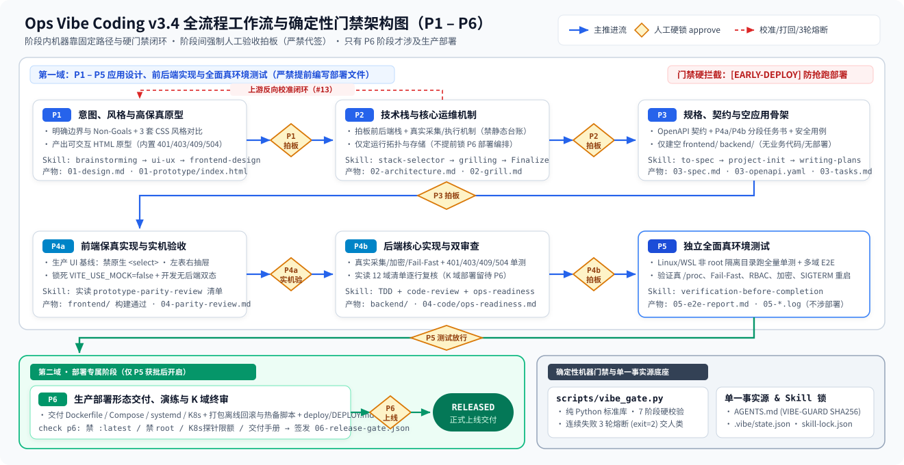

# Ops Vibe Coding v3.4

> 面向**不会写代码的运维工程师**、专为 **Codex**（兼顾 Antigravity）设计的**生产级 Web 运维平台 Vibe Coding 方法论与确定性门禁系统**。

核心理念：**阶段内让机器靠固定路径和硬门禁闭环，阶段间强制停手由人类验收拍板；先前端验收、再后端实现、再独立真环境测透，最后只在 P6 设计并验证生产部署。**

---

## 一、全流程 7 阶段架构与总览（P1 → P6）



> **阶段铁律**：**只有 P6 阶段才涉及部署设计、打包清单、交付手册与部署评估**；P1–P5 任何阶段严禁提前编写 `docker-compose.yml` / `Dockerfile` / `nginx.conf` / `systemd` 等部署文件（`vibe_gate.py` 自动拦截 `[EARLY-DEPLOY]`）。

| 阶段 | 核心目标 | 串联 Skill（Codex `$<name>`，高风险阶段必实读原文） | 强制人工确认点 |
|---|---|---|---|
| **P1 意图、风格与原型** | 定边界（含 Non-Goals）→ 3 套风格对比选定 → 可交互高保真原型 | `devops-brainstorming` → `ui-ux-pro-max` → `frontend-design` | 打开原型确认界面与交互 → `approve p1` |
| **P2 技术栈与核心机制** | 拍板前后端语言框架 + **核心运维采集/执行机制** + 存储与实例边界（**不提前锁部署形态**） | `stack-selector` → `grilling` → `stack-selector` | 确认技术栈与核心机制 → `approve p2` |
| **P3 规格、骨架与用例** | 输出 OpenAPI、规格、P4a/P4b 任务书、干净空应用骨架（**不含部署文件**） | `to-spec` → `project-init` → `devops-writing-plans` | 确认目录骨架、逻辑流与用例 → `approve p3` |
| **P4a 前端实机验收** | 保真还原原型（禁原生 `<select>`、左表右抽屉、无后端双态预览）并启动 | 按原型实现（仅选 MUI 时用 `html-to-mui-react`）→ `prototype-parity-review` | 浏览器实机点验前端 → `approve p4a` |
| **P4b 后端实现与互检** | 实现真实核心引擎 + 安全单测（401/403/409/504 不重试）+ 双审查（不含 P6 部署） | `test-driven-development` + `verification-before-completion` → `code-review` + `ops-readiness-review` | 验收联调效果与双审查 → `approve p4b` |
| **P5 全面真环境测试** | 在真实目标运行环境（如 WSL/Linux 非 root 隔离目录）跑透功能、安全、持久化与容错回归 | `verification-before-completion`（有浏览器环境可选 `playwright-e2e-debug-report`） | 核对实测日志与报告 → `approve p5` |
| **P6 生产部署与放行** | **测试全过后再定部署形态**（Docker Compose / `systemd`+Nginx / K8s），交付脚本、部署扫描、**运维交付手册（`deploy/DEPLOY.md`）**、备份回滚演练并签发 `06-release-gate.json` | `ops-readiness-review`（补全 K 域部署终审） | 确认交付手册与实机演练 → `approve p6` |

---

## 二、5 分钟快速上手（新运维 Web 项目）

### 1. 初始化项目（一键生成受保护的 `AGENTS.md` 与 `.vibe/state.json`）
```bash
# --mode: 含变更/巡检/邮件选 mutating，纯只读选 readonly
# --kind: web（默认前后端平台）/ service（无前端后端或Agent）/ cli（命令行工具）
python ../ops-vibe-coding/scripts/vibe_gate.py init \
  --project ./my-ops-platform \
  --name my-ops-platform \
  --mode mutating \
  --kind web
```

### 2. 在 Codex 中按阶段驱动（每步机器校验 + 人工拍板）
```bash
# 阶段完成由 Agent 自动运行硬校验（退出码 0 才算通过；连续失败 3 轮自动熔断交人类）
python ../ops-vibe-coding/scripts/vibe_gate.py check p1 --project .

# 人类验收满意后显式放行（严禁 Agent 代签）
python ../ops-vibe-coding/scripts/vibe_gate.py approve p1 --project . --by ops-user --note "原型确认通过"

# 随时查看全 7 阶段状态与命令配置
python ../ops-vibe-coding/scripts/vibe_gate.py status --project .
```

### 3. （推荐）在开发机 / CI 启用全部外部安全扫描器
`vibe_gate.py` 已内置自动探测钩子（未安装时如实记为 `SKIPPED`，装好即自动生效）：
```bash
pip install -i https://pypi.tuna.tsinghua.edu.cn/simple ruff bandit
# 可选二进制：gitleaks（防密钥泄漏）、hadolint（P6 Dockerfile 规范）；Go 项目自动跑 go vet
```

---

## 三、方法论核心文档与标杆案例

- **执行流程**：[workflow/pipeline.md](workflow/pipeline.md) — P1–P6 固定产物路径、部署专属 P6 边界、P2 反向校准与 P4a/P4b 分段规范
- **人工门禁与熔断**：[workflow/human-gates.md](workflow/human-gates.md) — 7 个硬锁点、阶段末三段大白话汇报模板与 3 轮熔断
- **运维与安全红线**：[workflow/risk-boundaries.md](workflow/risk-boundaries.md) — 应用级红线（P3–P5）vs 部署级红线（仅 P6）、401/403/409/504、Fail-Fast、动态凭据加密热配
- **生产前端 UI 基线**：[workflow/frontend-ui-baseline.md](workflow/frontend-ui-baseline.md) — 禁原生 `<select>`、去源码预览、左表右抽屉、10s 悬浮通知与运维人话文案
- **配套 Skill 路由与锁文件**：[references/skills.md](references/skills.md)、[references/skill-lock.json](references/skill-lock.json) — 含 10 处微调清单、实读防盲签规则及“何时走/不走 Skill”边界
- **端到端标杆案例**：[examples/ops-inspect-platform/](examples/ops-inspect-platform/) — **智能服务器巡检与定时邮件推送平台**（完整走通 P1–P6 全 7 阶段：Windows 20/20 + WSL Linux 单测 20/20 + 8 大域生产 E2E 32/32 + P6 Docker Compose 双非 root 编排/打包/离线导包/热备/回滚交付）
- **K8s 生产护栏模板（仅 P6 选用 K8s 时参考）**：[templates/k8s-guardrails/deployment.yaml](templates/k8s-guardrails/deployment.yaml)
